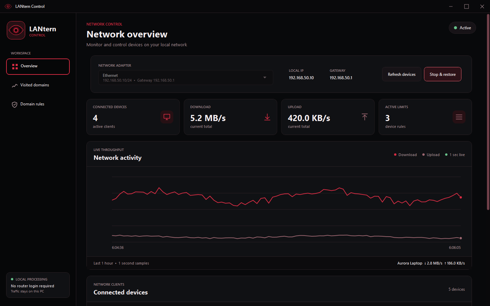
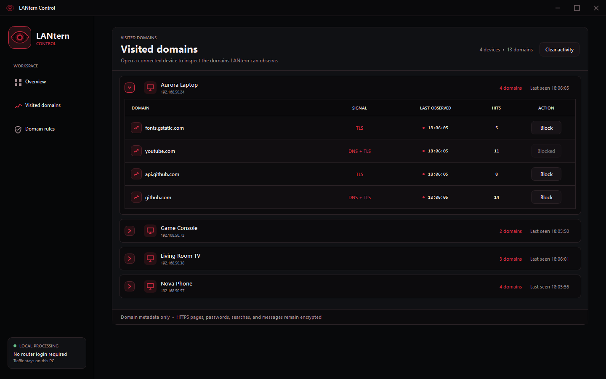

# Usage Meter

<a href="LICENSE"></a>


Usage Meter shows how much data each device on your local network has used,
and keeps those totals between restarts.

> [!NOTE]
> Usage Meter is based on
> [LANtern Control](https://github.com/humane125/LANtern-Control) by humane125,
> released under the MIT License. It is a modified version of LANtern Control,
> not a new project written from scratch. Device discovery, the ARP engine,
> packet capture, speed limits, domain features and the user interface all come
> from LANtern Control. See [NOTICE](NOTICE).

## What Usage Meter adds

- **Persistent per-device usage.** Usage Meter keeps a running total of
  download, upload and overall usage for every device it sees.
- **Keyed by MAC address, not IP.** If a device gets a new IP address, its
  existing total continues instead of starting again from zero.
- **Totals survive restarts.** Totals are loaded on startup and new traffic is
  added on top. They are saved every 30 seconds, when control stops, and when
  the app closes or Windows signs out, including traffic that was not yet shown
  in the table.
- **Refreshing the device list keeps totals.** Starting a new session or
  clearing the device list does not erase saved usage.
- **New columns in the Windows app:** `TOTAL DOWN`, `TOTAL UP` and
  `TOTAL USAGE`. Each column shows a readable size (KB, MB, GB, using
  1 KB = 1000 bytes) and the exact number of bytes. The live speed columns work
  the same as before.
- **No inherited update prompt.** The Windows app does not check the LANtern
  Control releases for updates and never offers to replace itself with a
  LANtern release.

## Features inherited from LANtern Control

- Discover devices connected to the same Ethernet or Wi-Fi network.
- Resolve device names using DHCP, reverse DNS, NetBIOS, and mDNS information.
- Remember device names, aliases, and rules between application launches.
- Display live per-device download and upload speeds.
- Keep a ten-minute network activity chart with 2.5-second samples.
- Apply independent download and upload limits in `KB/s`.
- Pause and restore a device's IPv4 internet connection.
- Observe domains through DNS queries, TLS server names, and plain HTTP host
  headers without decrypting private HTTPS content.
- Block domains for individual devices, including presets for common services.
- Restore normal client and router ARP mappings when control stops.

## Where data is stored

Usage Meter keeps its data in its own folder and never writes to the
`LANternControl` folder, so it can be installed next to LANtern Control.

```text
Settings:     %LOCALAPPDATA%\UsageMeter\settings.json
Usage totals: %LOCALAPPDATA%\UsageMeter\usage.json
```

Both files are written safely: the new content goes to a temporary file first,
which then replaces the old file, and a backup (`settings.backup.json`,
`usage.backup.json`) is kept beside each one. If `usage.json` cannot be read,
Usage Meter falls back to the backup instead of resetting totals to zero.

To reset all usage totals, close Usage Meter and delete `usage.json` and
`usage.backup.json`.

## Screenshots

The screenshots below come from the original LANtern Control project and use
synthetic demo data. They do not show the new usage columns.

### Network overview (LANtern Control)



### Visited domains (LANtern Control)



## Requirements

- Windows 10 or Windows 11, x64.
- Administrator access.
- [Npcap](https://npcap.com/#download) installed on the controller computer.
  WinPcap API-compatible mode is recommended for compatibility.

Usage Meter does not include or redistribute Npcap. Install Npcap separately
from its official website, then restart Usage Meter.

The controller computer and target devices must be on the same IPv4 broadcast
network. Ethernet is recommended. If Wi-Fi is used, keep the controller near
the router and prefer 5 GHz when possible.

Windows is the target platform for Usage Meter 1.0.0. The Linux project from
LANtern Control still builds, but the usage columns are only in the Windows
app.

## Installation

Build the installer or portable version from source (see below). The build
produces:

- `Usage-Meter-Setup-v1.0.0.msi`: run it, choose the installation folder and
  shortcuts, then launch Usage Meter and accept the Administrator prompt.
- `Usage-Meter-v1.0.0-win-x64.zip`: extract the whole archive to a folder where
  it can stay, then run `Usage Meter.exe` as Administrator.

The Usage Meter installer is separate from the LANtern Control installer and
does not replace an existing LANtern Control installation.

Always click **Stop & restore** before closing Usage Meter, changing networks,
disconnecting the selected adapter, suspending, or rebooting.

## How to use

1. Launch Usage Meter as Administrator.
2. Select the network adapter whose local IP address and gateway match the
   network you want to measure.
3. Click **Start control** and wait for connected devices to appear.
4. Watch the `TOTAL DOWN`, `TOTAL UP` and `TOTAL USAGE` columns grow as each
   device uses the network.
5. Click **Refresh devices** when you want to run a fresh discovery scan.
   Totals are kept.
6. Click **Stop & restore** before changing adapters, leaving the network, or
   shutting down the controller computer.

Usage is only counted while Usage Meter is running and control is active.
Traffic a device uses while Usage Meter is closed is not counted.

No router username or password is required, and Usage Meter does not
permanently change the router configuration.

## Domain visibility and blocking

The domain features come from LANtern Control. They do not decrypt HTTPS, read
searches, inspect messages, or view private page contents. Domain blocking is
best effort because applications may use cached connections, several CDN
domains, or encrypted protocols.

The following can hide domains or bypass domain-based rules:

- VPNs, Tor, and proxy applications.
- Encrypted DNS such as DoH or DoT.
- TLS Encrypted Client Hello (ECH).
- QUIC/HTTP3 and cached or already-open connections.
- Applications that use direct IP addresses or frequently changing domains.

## Network compatibility

Usage Meter works on the local IPv4 network rather than through a
router-specific API, so it can work with many ordinary home routers. It cannot
be guaranteed on every network or adapter.

- IPv6 traffic is not measured or controlled in this release.
- Guest Wi-Fi or client isolation can prevent discovery and measurement.
- Dynamic ARP inspection or other ARP protection can block interception.
- Devices behind another router or NAT are not on the same broadcast LAN.
- Some Wi-Fi drivers do not reliably support packet capture or injection.
- While a device is redirected, the controller computer becomes part of its
  traffic path. A weak controller connection can reduce speed or increase
  latency for that device.
- The controller must remain awake and connected while measuring.

## Troubleshooting

### Npcap is not detected

Install the latest version from the [official Npcap download page](https://npcap.com/#download),
enable WinPcap API-compatible mode if offered, and restart Usage Meter.

### Devices do not appear

- Confirm that the correct adapter is selected.
- Make sure the controller and devices are on the same normal LAN, not an
  isolated guest network.
- Run Usage Meter as Administrator.
- Click **Refresh devices** and allow the discovery scan to finish.

### A device loses connectivity

Click **Stop & restore** and wait for the application to repair the normal ARP
mappings. If connectivity does not return, reconnect the affected device to
Wi-Fi or disable and re-enable its network adapter.

## Building from source

Requires the .NET 8 SDK. The WiX 5 SDK used to produce the Windows MSI is
restored automatically by `dotnet`.

```powershell
dotnet test .\tests\Lantern.Core.Tests\Lantern.Core.Tests.csproj
dotnet test .\tests\Lantern.App.Tests\Lantern.App.Tests.csproj
.\scripts\publish.ps1
```

The publishing script runs those tests, then creates the portable ZIP and the
MSI installer in the `outputs` folder.

The project, namespace and solution names (`Lantern.*`, `LanternControl.slnx`)
were kept from LANtern Control to keep the changes small.

## License

Usage Meter is released under the [MIT License](LICENSE).

- Copyright (c) 2026 humane125 (LANtern Control)
- Copyright (c) 2026 mahmoud-pixel7 (Usage Meter modifications)

See [NOTICE](NOTICE) and [THIRD-PARTY-NOTICES.txt](THIRD-PARTY-NOTICES.txt).

## Responsible use

Use Usage Meter only on networks and devices that you own or are authorized to
administer. Monitoring, limiting, pausing, or blocking another person's traffic
without permission may violate policies or local laws.

## Feedback and bug reports

If you find a problem, [open a GitHub issue](https://github.com/mahmoud-pixel7/usage-meter/issues)
and include the Usage Meter version, Windows version, adapter type, Npcap
version, router model, and steps needed to reproduce it.

Please report problems in Usage Meter here rather than to the LANtern Control
project.
